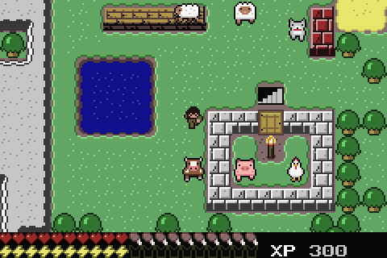
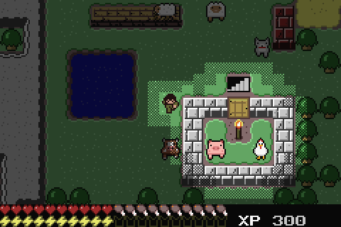
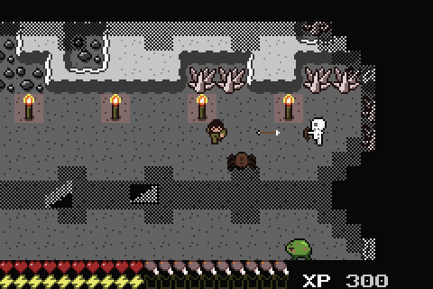
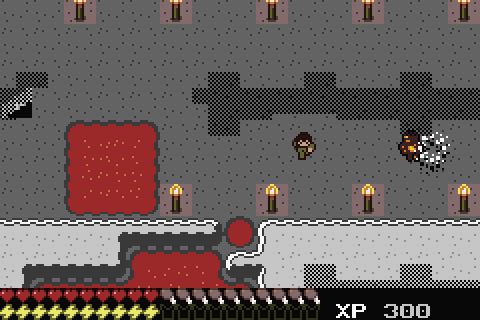

# Minicraft Expanded Edition

A fork of Vulcalien's [Minicraft for GBA](https://github.com/Vulcalien/minicraft-gba) that adds
Minecraft-style content to the Game Boy Advance demake of Notch's Minicraft – **without using more RAM**
than the original port. Everything runs on real GBA hardware limits: the world, levels and entity cap are
unchanged, and new code lives in ROM. All new art is original pixel art.

| | |
|---|---|
|  |  |
| Day: placed walls join like rock, animals wander | Night: torches and the player light the dark |
|  |  |
| Underground: skeletons, spiders and bloaters | The magma golem guards the deepest level |

## What's new

**Blocks** – coal ore, obsidian, planks, stone bricks, clay bricks, doors, pumpkins, melons, sugar cane,
mushrooms, torches, spawners and ice. Placed planks and bricks join into walls like the original rock,
with a lit top and a shaded south face; doors fit into them.

**Mobs** – cows, pigs, chickens (lay eggs), sheep (shear for wool), wolves (tame them with a bone),
skeletons (archers), spiders, bloaters (exploding fungus) and the **magma golem**, a boss guarding the
deepest level.

**Survival**
- Hunger: food fills it, HP regenerates while you're fed.
- Armor in four tiers (leather, iron, gold, gem); the HUD shows the worn tier by colour.
- Experience from monsters, spawners and ore, spent at the **enchanting table** (level I and II: less
  stamina, more damage).
- **Day and night**: nights darken the surface, monsters come out, and torches, lanterns and the player
  light the dark. A **bed** sets your respawn point, sleeps through the night and saves the game.

**Items** – buckets (water and lava; water on lava makes obsidian), shears, bow and arrows, fishing rod,
map, cooked meat and fish, mushroom stew, cake, paper, wool, string, bones and more: 40 new items with
workbench, furnace, oven and anvil recipes.

**Quality of life** – short status messages explain what happened ("CANT PLACE", "NEED 30 XP",
"FISH!", "SAVED"...), crafting shows how many items a recipe makes, and saves use 128 KB Flash so large
worlds fit.

Full rules, numbers and recipes: [`docs/game-design.md`](docs/game-design.md). Art and palettes:
[`docs/art-pack.md`](docs/art-pack.md), previews in [`docs/previews`](docs/previews).

## Controls
Same as the original: **A** attacks / uses the item in hand, **B** opens the inventory or uses furniture
in front of you (crafting stations, chests, bed, enchanting table), **Start** pauses (save game).
Placing blocks, pouring buckets, casting the rod and equipping armor are all **A** with the item in hand.

## Playing
Download the ROM from the [Releases](https://github.com/altmihai31/minicraft-gba/releases) page, or the
latest build from the [Actions](https://github.com/altmihai31/minicraft-gba/actions) tab (needs a GitHub
login), and open it in a GBA emulator such as mGBA. Saves use 128 KB Flash.

## Building
Needs `arm-none-eabi-gcc`, Python 3 with Pillow, and `make`:
```sh
git clone --recursive https://github.com/altmihai31/minicraft-gba
cd minicraft-gba
make -C lib/libsimplegba
make res && make          # -> bin/minicraft-expanded-edition.gba
```
Windows steps, the debug ROM (`make DEBUG_KIT=1`) and the automated test (`make test`):
[`BUILDING.md`](BUILDING.md). Changes: [`CHANGELOG.md`](CHANGELOG.md).

The rest of this file is the original Minicraft for GBA readme.

## Minicraft for GBA

This is a demake of Minicraft by Markus Persson (aka Notch), a game made
for Ludum Dare 22 in two days.

My aim is to make a version that is as close as possible to the
original. Of course, the GBA has some hardware limitations but, since
the game isn't too complex, I could port it without too many problems.
When the limitations were impossible to overcome, I had to hack a few
things, change others, put limits and so on.

To improve the gameplay experience, I also added these features:
- a pause menu
- saving and loading the world
- a way to respawn, with or without keeping the inventory

## Differences due to Hardware limitations
|                | Original | GBA Demake |
| -------------- | :------: | :--------: |
| World size     | 128x128  | 112x112    |
| Entity limit   | ∞        | 255        |
| Chest limit    | ∞        | 32         |
| Inventory size | ∞        | 96         |

### Game Light
The light system is completely different, both visually and in how it
works. The original Minicraft calculates the light for **each pixel**:
that is, for various reasons, impractical to do on the GBA.

So I had to find another way, and the best one seemed to use tiles,
because the GBA is very good at handling them. That gives light a
'blocky' look, but it seems acceptable.

## Running
Download or build the ROM (`.gba` extension). Then open it with your GBA
emulator of choice. If you don't have one, I highly recommend mGBA.

### Performance Overlay
By holding the `L` and `R` buttons down and then pressing `Select`, the
performance overlay is enabled.\
Four hexadecimal values and two decimal values are written at the top of
the screen:
```
FF <--- vcount after 'tick'     entity count ---> FF
FF <--- vcount after 'draw'     sprite count ---> FF

60 <--- tps (ticks per second)
60 <--- fps (frames per second)
```

## Building
To build the game, I use the `Makefile` present in the files.
You will need the gcc-arm-none-eabi compiler and Python 3.

First, run `make res` to convert the necessary resources. Then, run
`make` to build the ROM.

## License
The original game `Minicraft` was made by Markus Persson in 2011.
I do not own it, nor am I affiliated to it.

This demake of the game is released under the GNU General Public
License, either version 3 of the License or any later version.
